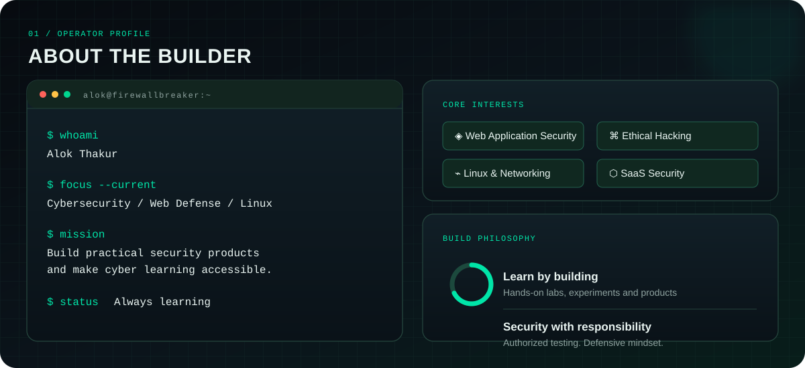
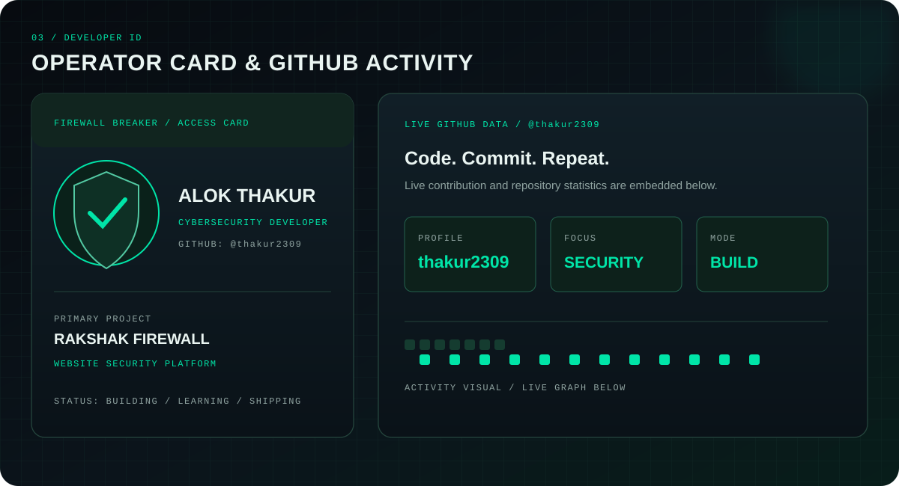
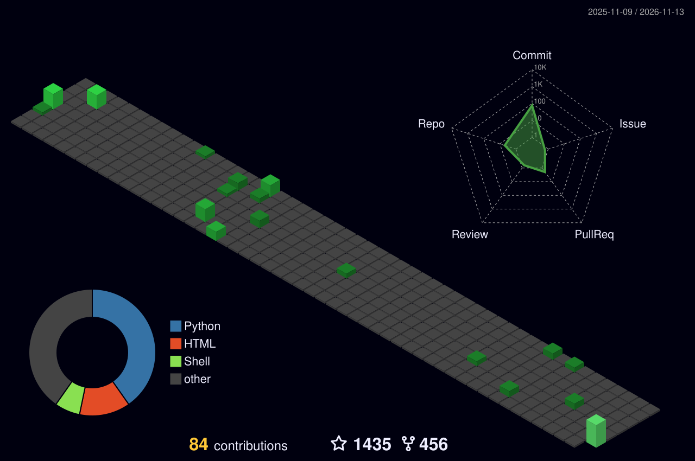

 

 

## 🛡️ Featured Projects

| Project | What it is | Focus |
|:--|:--|:--|
| **[Rakshak Firewall](https://www.rakshakfirewall.com)** | A website security platform focused on monitoring website traffic, identifying suspicious activity, security alerts and IP access management. | Web Security · Threat Monitoring · SaaS |
| **[Firewall Breaker](https://www.firewallbreaker.site)** | My cybersecurity learning and creator platform. I share practical content around ethical hacking, Termux, Kali Linux, Linux and cyber awareness. | Cybersecurity Education · Ethical Hacking |
| **[Cyber Safe India](https://github.com/thakur2309?tab=repositories)** | A project concept focused on helping people identify and understand scam phone numbers and digital fraud risks. | Scam Awareness · Python · FastAPI |
| **[Explore More Projects →](https://github.com/thakur2309?tab=repositories)** | Explore my repositories, experiments and ongoing builds. | Development · Security · Learning |

 

 

 

[**GitHub**](https://github.com/thakur2309) &nbsp;·&nbsp; [**Firewall Breaker**](https://www.firewallbreaker.site) &nbsp;·&nbsp; [**Rakshak Firewall**](https://www.rakshakfirewall.com) &nbsp;·&nbsp; [**YouTube**](https://www.youtube.com/@FirewallBreaker09) &nbsp;·&nbsp; [**LinkedIn**](https://www.linkedin.com/company/rakshak-firewall/)

## 🏙️ 3D Contribution City

## 🐍 Contribution Snake

*Think like an attacker. Build like a defender. Create with purpose.*

