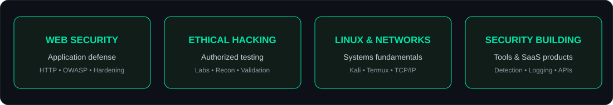

<div align="center">


<br/>

[](https://www.firewallbreaker.site)
[](https://www.rakshakfirewall.com)
[](https://www.youtube.com/@FirewallBreaker09)
[](https://www.linkedin.com/company/rakshak-firewall/)

</div>

---

## `whoami`

```bash
alok@firewall-breaker:~$ whoami
Alok Thakur

alok@firewall-breaker:~$ role
Cybersecurity Developer • Ethical Hacking Educator • SaaS Builder

alok@firewall-breaker:~$ mission
Making practical cybersecurity knowledge and website security tools
more accessible to developers, startups, and learners.

alok@firewall-breaker:~$ motto
"Build securely. Learn continuously. Stay curious."
```

I'm an India-based cybersecurity enthusiast and developer focused on practical security, ethical hacking education, Linux environments, and building useful security products. I enjoy turning security concepts into hands-on learning experiences and tools that help people understand and improve their website security.

## `./flagship-projects`

<table>
<tr>
<td width="50%" valign="top">

### <a href="https://www.rakshakfirewall.com">RAKSHAK FIREWALL</a>


A website security monitoring and response platform.

- Request-level traffic visibility
- Rule-based threat detection
- Suspicious activity alerts
- IP block management through supported middleware
- Website security scanner
- Team workspaces, reports and API capabilities

**Live:** [rakshakfirewall.com](https://www.rakshakfirewall.com)

</td>
<td width="50%" valign="top">

### <a href="https://www.firewallbreaker.site">FIREWALL BREAKER</a>


A cybersecurity learning and creator platform focused on practical education.

- Ethical hacking learning content
- Termux and Kali Linux tutorials
- Beginner-friendly security concepts
- Practical labs and tool walkthroughs
- Cybersecurity awareness

**Live:** [firewallbreaker.site](https://www.firewallbreaker.site)

</td>
</tr>
</table>

## `./security-focus`

<div align="center">

</div>

- **Web Security:** Understanding common web attack patterns and defensive practices.
- **Ethical Hacking:** Authorized testing, practical labs, and responsible disclosure principles.
- **Linux & Networking:** Working with Linux environments, command-line tools, and network fundamentals.
- **Security Tooling:** Building and experimenting with tools for learning and defensive use.
- **SaaS Security:** Product security, authentication, access control, logging, and operational safeguards.

## `./technology-stack`

<div align="center">

**Languages & scripting**


**Development**


**Platforms & tools**


</div>

## `./github-activity`

<div align="center">
  
  
</div>

<div align="center">
  
</div>

## `./contribution-graph`

<div align="center">
  
</div>

## `./connect`

<div align="center">
  <a href="https://www.firewallbreaker.site"></a>
  <a href="https://www.rakshakfirewall.com"></a>
  <a href="https://www.youtube.com/@FirewallBreaker09"></a>
  <a href="https://www.linkedin.com/company/rakshak-firewall/"></a>
  <a href="https://github.com/thakur2309"></a>
</div>

---

<div align="center">


<sub>Built with curiosity, code, and a security-first mindset.</sub>

</div>

<!--
PROFILE SETUP
1. Create a PUBLIC repository named exactly: thakur2309
2. Upload README.md, assets/, and .github/ from this package to its root.
3. Enable GitHub Actions in repository Settings → Actions → General.
4. The snake workflow generates the contribution animation after the first successful run.
5. GitHub stats images are served by third-party public services and may occasionally be unavailable.
-->
