 

 

 

[**PAGASUS-PRO**](https://github.com/thakur2309/PAGASUS-PRO) &nbsp;·&nbsp; [**PhoneXtract**](https://github.com/thakur2309/phonextract) &nbsp;·&nbsp; [**EYESPY**](https://github.com/thakur2309?tab=repositories) &nbsp;·&nbsp; [**All Repositories →**](https://github.com/thakur2309?tab=repositories)

> ⚠️ **Disclaimer:** All tools and content here are created strictly for **education, research and authorized security testing**. Use them only on systems and devices you own or have explicit written permission to test. The author is not responsible for any misuse.

 

 

[**YouTube**](https://www.youtube.com/@FirewallBreaker09) &nbsp;·&nbsp; [**Instagram**](https://www.instagram.com/sudo_xploit) &nbsp;·&nbsp; [**WhatsApp**](https://whatsapp.com/channel/0029VbAiqVMKLaHjg5J1Nm2F) &nbsp;·&nbsp; [**Website**](https://www.firewallbreaker.site) &nbsp;·&nbsp; [**Email**](mailto:businessfirewall@gmail.com)

 

 

