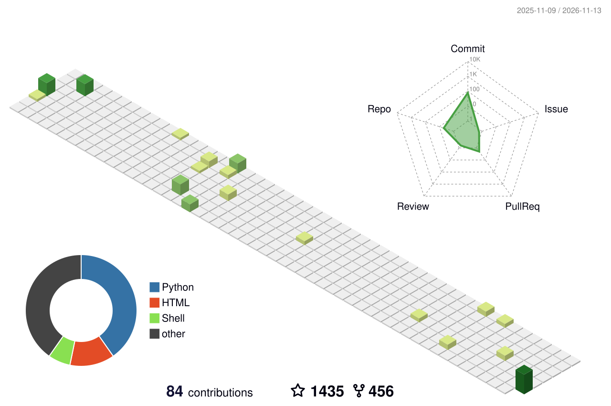

<div align="center">


</div>

<br/>

<div align="center">

</div>

<br/>

<div align="center">

</div>

## 🛡️ Featured Tools

| Tool | What it is | Built with |
|:--|:--|:--|
| **[PAGASUS-PRO](https://github.com/thakur2309/PAGASUS-PRO)** | Android device controlling toolkit (research and authorized testing). | Python |
| **[PhoneXtract](https://github.com/thakur2309/phonextract)** | Phone number OSINT tool. | Python |
| **[Camhack](https://github.com/thakur2309/Camhack)** | Camera access research tool. | HTML |
| **[IP-HOPPRR](https://github.com/thakur2309/IP-HOPPRR-)** | IP rotation tool for security research. | Shell |
| **[More Tools →](https://github.com/thakur2309?tab=repositories)** | Everything else I'm building. | Python · Bash |

> ⚠️ **Disclaimer:** All tools and content here are created strictly for **education, research and authorized security testing**. Use them only on systems and devices you own or have explicit written permission to test. The author is not responsible for any misuse.

<br/>

<div align="center">

</div>

<br/>

<div align="center">


[**YouTube**](https://www.youtube.com/@FirewallBreaker09) &nbsp;·&nbsp; [**Instagram**](https://www.instagram.com/sudo_xploit) &nbsp;·&nbsp; [**WhatsApp**](https://whatsapp.com/channel/0029VbAiqVMKLaHjg5J1Nm2F) &nbsp;·&nbsp; [**Website**](https://www.firewallbreaker.site) &nbsp;·&nbsp; [**Email**](mailto:businessfirewall@gmail.com)

</div>

## 📊 GitHub Stats

<div align="center">


</div>

## 🏙️ Contribution City

<div align="center">

</div>

## 🐍 Contribution Snake

<div align="center">


<br/>

```
[ SESSION TERMINATED ]  —  Thanks for visiting. Stay legal. Stay curious.
```

*Stay Curious. Stay Secure.*
</div>
